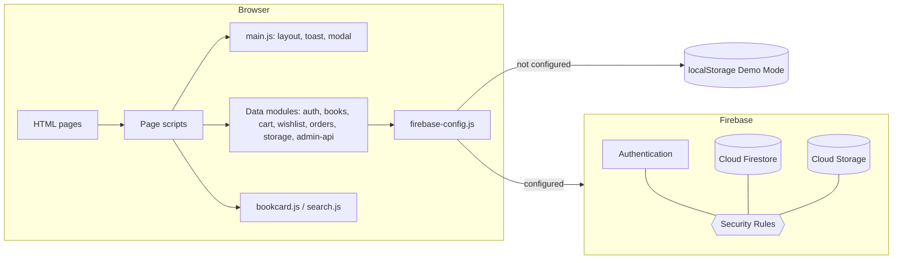
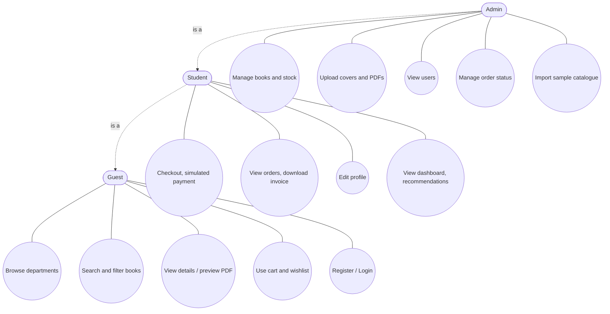
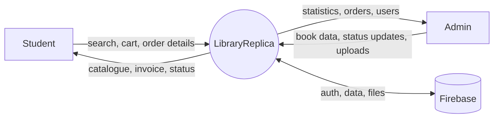
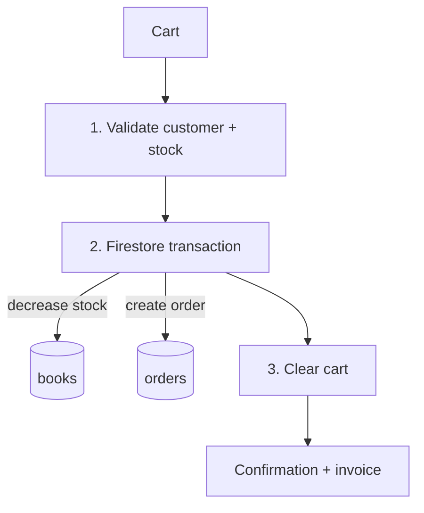
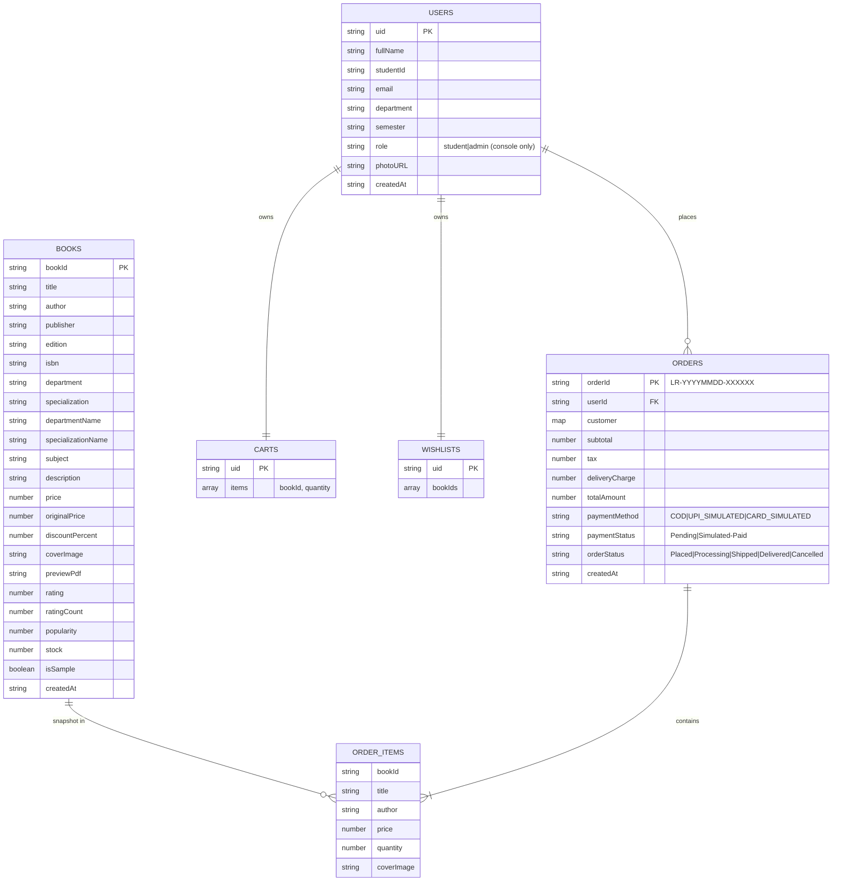

# LibraryReplica: University Online Bookstore

**Project report (academic mini-project)**

> LibraryReplica is an independent academic project. It is not affiliated with Jain University or any other institution. All catalogue data is sample data and all payments are simulated.

## 1. Abstract

LibraryReplica is a responsive web application that imitates a commercial university bookstore. Students browse a sample catalogue of 960 academic titles organised into 12 departments and 16 categories, preview sample PDFs, keep a cart and wishlist and complete a simulated checkout that produces a printable invoice. Administrators manage books, uploads, users and orders. The system is built with HTML5, CSS3 and vanilla JavaScript ES modules, using Firebase Authentication, Cloud Firestore and Cloud Storage. It also ships with a complete localStorage Demo Mode so the entire application can be demonstrated without any configuration.

## 2. Introduction

University students usually buy textbooks through scattered channels: campus shops with limited stock visibility, generic marketplaces with weak department filtering, or photocopies. A dedicated, well-organised online bookstore improves discovery and convenience. LibraryReplica explores how such a store can be designed and implemented with only web standards and a serverless backend, as a learning project in full-stack web development, UX design and security-minded data modelling.

## 3. Problem Statement

Students find it hard to locate the right books for their department and semester, compare prices and availability, preview content before purchasing, and track orders in a single clean interface. Administrators lack a simple tool to maintain the catalogue and fulfil orders. The project asks: *can a premium, secure, department-oriented bookstore be built without frameworks or a custom server?*

## 4. Objectives

1. Provide department and specialization-based browsing of a large catalogue.
2. Offer fast search with suggestions, filters, sorting and pagination.
3. Allow PDF sample previews and rich book details.
4. Implement cart, wishlist, simulated checkout, invoices and order history.
5. Provide an admin console for catalogue, uploads, users and orders.
6. Enforce authorisation with Firestore/Storage security rules, not UI checks.
7. Deliver a responsive, accessible, dark-mode capable interface.
8. Run end-to-end with zero setup in Demo Mode.

## 5. Scope

**In scope:** student and admin roles; catalogue of sample data; simulated payments; Firebase backend; responsive UI; documentation.
**Out of scope:** real payment gateways, real shipping, real publisher content or copyrighted books, e-mail notifications, server-side code (Cloud Functions), multi-language support.

## 6. Existing System

Typical existing options are campus bookshops (manual stock, no online catalogue), general e-commerce marketplaces (no department taxonomy, noisy results) and unorganised document sharing. They lack a unified view of department books, previews, wishlist and order tracking tailored to students.

## 7. Proposed System

A single-page-style multi-page web app with: a landing page; authentication; a department tree; a searchable and filterable catalogue; interactive 3D flip book cards; book details with PDF preview; cart and wishlist; simulated checkout with invoice; student dashboard and profile; and an admin console. Persistence is Firebase (Auth, Firestore, Storage) with a localStorage Demo Mode fallback.

## 8. Software and Hardware Requirements

| Category | Requirement |
|---|---|
| Client hardware | Any device with a modern browser; 2 GB RAM recommended |
| Developer hardware | Laptop with 4 GB RAM or more |
| OS | Windows, macOS or Linux |
| Browser | Chrome, Edge, Firefox or Safari (latest two versions) |
| Editor / tools | VS Code + Live Server, Git/GitHub, Node.js 18+ (catalogue generation) |
| Backend | Firebase project (Auth, Firestore, Storage); optional |
| Network | Internet for CDN fonts/icons and Firebase |

## 9. Technologies Used

- **HTML5, CSS3** (custom properties design system, grid, flexbox, 3D transforms, view transitions)
- **JavaScript ES2020+ modules**, no frameworks or build tools
- **Firebase v10 modular SDK** from the CDN: Authentication, Cloud Firestore, Cloud Storage
- **Font Awesome** icons, **Google Fonts** (Playfair Display, Inter)
- **Node.js** script to generate the sample catalogue
- **Next.js wrapper** used only to serve the static site in the build environment

## 10. System Architecture

Layers: presentation (HTML/CSS/page scripts), shared UI (`main.js`), domain/data modules that never touch the DOM, and the Firebase or localStorage persistence layer. Authorisation is enforced by security rules; UI checks are convenience only.

## 11. Use Case Diagram

## 12. Data Flow Diagram

Level 0 (context):

Level 1 (checkout):

## 13. Database Design

Firestore collections (field names exact):

Security rules summary: users read/write only their own profile and can never change `role`; books are public-read, admin-write, and students may only lower `stock`; carts and wishlists are owner-only; orders are created by their owner with status `Placed`, readable by owner or admin, and only `orderStatus`/`paymentStatus` can be updated by an admin; no deletes.

## 14. Module Description

| Module | Responsibility |
|---|---|
| `config.js`, `firebase-config.js` | Constants; Firebase initialisation and Demo Mode switch; error mapping |
| `main.js` | Navbar, footer, theme, toast, modal, confirm dialog, helpers |
| `auth.js` | Register, login, logout, reset, profile update, role-checked guards |
| `books.js` | Catalogue loading/caching, taxonomy, recommendations, admin CRUD, import |
| `search.js` | Search, suggestions, filters, sorting, pagination, facets |
| `bookcard.js` | 3D flip card, PDF preview modal, shared book UI |
| `cart.js`, `wishlist.js` | Stock-aware cart and wishlist with login merge and live events |
| `orders.js` | Transactional order creation, order queries, invoice generation |
| `storage.js` | Validated Storage uploads |
| `admin-api.js`, `admin.js` | Admin statistics, users, console UI |
| `dashboard.js`, `profile.js`, `checkout.js` | Page controllers |
| `data/generate-books.js` | Deterministic generation of 960 sample books |

## 15. Screenshots (placeholder list)

Insert real screenshots here after running the project:

1. Landing page (hero) in light and dark mode
2. Departments page with the CSE specializations expanded
3. Catalogue with filters and pagination
4. Flip card (front and back)
5. Book details with PDF preview modal
6. Cart and wishlist
7. Checkout with the simulated payment banner
8. Order confirmation and invoice
9. Student dashboard
10. Profile page
11. Admin console: stats, books table, orders, import progress
12. Mobile views at 360 px (navbar menu, catalogue, cart)

## 16. Testing and Results

| ID | Test case | Expected result | Result |
|---|---|---|---|
| TC01 | Submit empty registration form | Field errors shown, no account created | Implemented; to be confirmed in browser |
| TC02 | Register with invalid email | "Please enter a valid email address." | Pass (data layer) |
| TC03 | Login with wrong password | "Incorrect email or password." | Pass (data layer) |
| TC04 | Add the same book twice | One cart line, quantity 2 | Pass (data layer) |
| TC05 | Add more copies than stock | Quantity capped / error | Pass (data layer) |
| TC06 | Add an out-of-stock book | Refused, button disabled | Pass (data layer) |
| TC07 | Open checkout with empty cart | Redirect to cart with a toast | Implemented; to be confirmed in browser |
| TC08 | Phone number with fewer than 10 digits | Validation error | Pass (data layer) |
| TC09 | Book without a cover | Placeholder cover shown | Implemented; to be confirmed in browser |
| TC10 | Preview a book without PDF | "Preview not available" | Implemented; to be confirmed in browser |
| TC11 | Student opens `admin.html` | Redirect to `index.html?error=admin_only` | Implemented; to be confirmed in browser |
| TC12 | Database unavailable | Friendly error toast | Implemented; to be confirmed in browser |
| TC13 | Toggle dark mode, reload | Theme persists | Implemented; to be confirmed in browser |
| TC14 | Flip card via mouse, touch, keyboard | Card flips in all cases | Implemented; to be confirmed in browser |
| TC15 | Change filters | URL parameters update | Implemented; to be confirmed in browser |
| TC16 | Place an order | Order saved, stock reduced, cart cleared | Pass (data layer) |
| TC17 | Download invoice | New window opens and prints | Implemented; to be confirmed in browser |
| TC18 | Resize to 360/768/1280 px | No horizontal scroll | Implemented; to be confirmed in browser |
| TC19 | Use app without Firebase | All features work in Demo Mode | Pass (data layer) |
| TC20 | Student reads another user's order | Access denied | Pass (data layer); rules to be tested in emulator |

The "Pass (data layer)" results come from an automated Node harness (48 assertions) that runs the data modules in demo mode. Browser and Firebase-rule tests must be executed by the team and the table updated.

## 17. Advantages

- Department-first discovery with 960 organised sample titles
- No framework or build step: easy to understand and demonstrate
- Zero-setup Demo Mode plus a real Firebase mode
- Security enforced in rules; roles stored only in Firestore
- Accessible, responsive, dark-mode capable UI with polished interactions
- Transactional checkout keeps stock and orders consistent

## 18. Limitations

- Payments, shipping and e-mail are simulated
- Client-side checkout means stock and price integrity rely on rules; a Cloud Function would be stricter
- The whole catalogue is loaded in memory (suitable for about one thousand books)
- Demo Mode is not secure and is for demonstration only
- No automated browser tests are included

## 19. Future Enhancements

- Cloud Functions for server-side order validation, price recomputation and stock management
- Real payment gateway integration (e.g. UPI/Card via a PCI-compliant provider)
- Server-side search (e.g. Algolia/Firestore indexes) and pagination
- Reviews and ratings by verified buyers, e-mail notifications, PWA/offline support
- Editable department taxonomy and multi-campus support
- Automated end-to-end tests (Playwright) and CI

## 20. Conclusion

LibraryReplica demonstrates that a feature-rich, secure, premium-quality online bookstore can be built using standard web technologies and a serverless backend. It covers the full student journey from discovery to a simulated order and the administrator's catalogue and order management, while documenting its trade-offs honestly and offering a clear path toward a production-grade design.

## 21. References

1. Firebase Documentation: Authentication, Cloud Firestore, Cloud Storage and Security Rules. https://firebase.google.com/docs
2. MDN Web Docs: JavaScript modules, CSS 3D transforms, IntersectionObserver, `prefers-reduced-motion`. https://developer.mozilla.org
3. W3C: Web Content Accessibility Guidelines (WCAG) 2.1. https://www.w3.org/TR/WCAG21/
4. Font Awesome Free documentation. https://fontawesome.com/docs
5. Google Fonts: Playfair Display and Inter. https://fonts.google.com
6. Mermaid documentation for diagrams. https://mermaid.js.org
